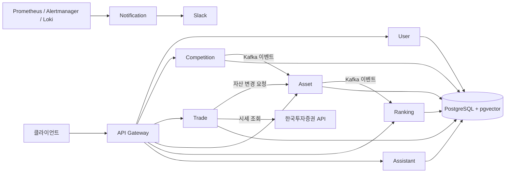

# AntCamp

AntCamp는 가상 자산으로 주식 거래 대회에 참가하는 모의투자 플랫폼입니다. 사용자는 대회에 신청해 전용 계좌를 받고, 실시간 시세를 참고해 주식을 매매하며, 대회 종료 후 확정된 순위를 확인할 수 있습니다. 운영을 위한 문서 기반 AI 챗봇과 모니터링 알림 기능도 포함합니다.

## 주요 기능

- **대회 운영:** 대회 생성, 참가 신청과 취소, 상태 전환, 종료 및 순위 확정
- **모의 거래:** 한국투자증권(KIS) 시세 조회, 시장가·지정가 주문, 미체결 주문 처리
- **자산과 랭킹:** 대회별 계좌·보유 종목 관리, 자산 평가, Redis 랭킹 및 최종 결과 저장
- **AI 도우미:** 운영 문서를 pgvector에 적재해 검색하고, 관련 문서를 근거로 답변하는 RAG 챗봇
- **운영 알림:** Prometheus 알림에 메트릭·로그·LLM 분석을 더해 Slack으로 전달하고, 운영자 승인 후 조치 실행

## 시스템 구성



서비스 발견에는 Eureka를, 서비스별 외부 설정에는 Spring Cloud Config를 사용합니다. PostgreSQL은 서비스별 스키마로 데이터를 분리하고 Redis는 캐시와 랭킹 등에 사용합니다.

| 모듈 | 역할 |
| --- | --- |
| `api-gateway` | API 라우팅과 JWT 검증 |
| `user-service` | 회원, 로그인, 토큰 관리 |
| `competition-service` | 대회 및 참가자 관리, 대회 이벤트 발행 |
| `trade-service` | 시세 조회와 모의 주문 처리 |
| `asset-service` | 계좌, 잔액, 보유 종목 및 자산 평가 |
| `ranking-service` | 대회 랭킹 조회와 최종 순위 저장 |
| `assistant-service` | 문서 수집, RAG 채팅, 답변 평가 |
| `notification-service` | 모니터링 웹훅, AI 분석, Slack 알림 및 운영 조치 |
| `eureka-server` / `config-server` | 서비스 발견 / 중앙 설정 |
| `common` | 여러 서비스가 공유하는 응답·예외·엔티티 코드 |

## 기술 스택

Java 17, Spring Boot 3.5, Spring Cloud, Spring Kafka, Spring AI, PostgreSQL/pgvector, Redis, Docker Compose를 사용합니다. 모니터링 구성은 Prometheus, Alertmanager, Grafana, Loki, Zipkin을 포함합니다.

## 로컬 실행

Java 17, Docker 및 Docker Compose가 필요합니다. 이 저장소는 [설정 저장소](https://github.com/ants-camp/ants-camp-config)의 서비스별 설정과 KIS·LLM·Slack 등의 외부 자격 증명을 사용합니다.

1. `.env.example`을 참고해 루트 `.env`를 작성하고, 사용할 서비스의 포트·DB·Redis·Kafka·JWT 및 외부 API 설정을 채웁니다. `.env.example`은 설정 항목의 예시이며 현재 Compose의 모든 변수를 망라하지는 않습니다.
2. `CONFIG_GIT_URI`, `CONFIG_GIT_BRANCH`, `CONFIG_SERVER_URL`을 실행 환경에 맞게 설정하고 Config Server가 해당 설정 저장소에 접근할 수 있는지 확인합니다.
3. 저장소 루트에서 `docker compose --profile prod up --build`를 실행합니다. 필요 서비스만 실행하려면 Compose 서비스 이름을 뒤에 지정합니다.

```bash
./gradlew build -x test
./gradlew test
```

첫 번째 명령은 전체 모듈을 빌드하고, 두 번째 명령은 테스트를 실행합니다. 일부 테스트는 Kafka·Redis 등 테스트용 설정이 필요합니다. 설정 파일과 토큰은 저장소에 커밋하지 마세요.

## 저장소 안내

- [`apps/`](apps/): 서비스별 애플리케이션
- [`common/`](common/): 공통 Java 모듈
- [`docker-compose.yml`](docker-compose.yml): 로컬 서비스와 인프라 구성
- [`monitoring/`](monitoring/): 메트릭, 로그, 알림 및 대시보드 구성
- [`rag-architecture.md`](rag-architecture.md): RAG 설계와 데이터 흐름
- [`aiops-architecture.md`](aiops-architecture.md): 운영 알림과 승인 기반 조치 흐름
